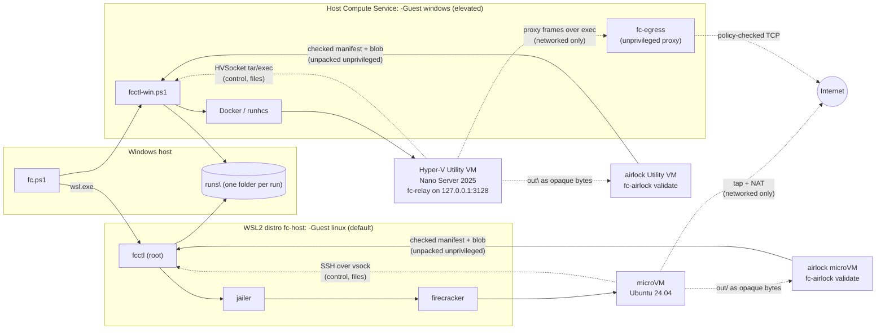
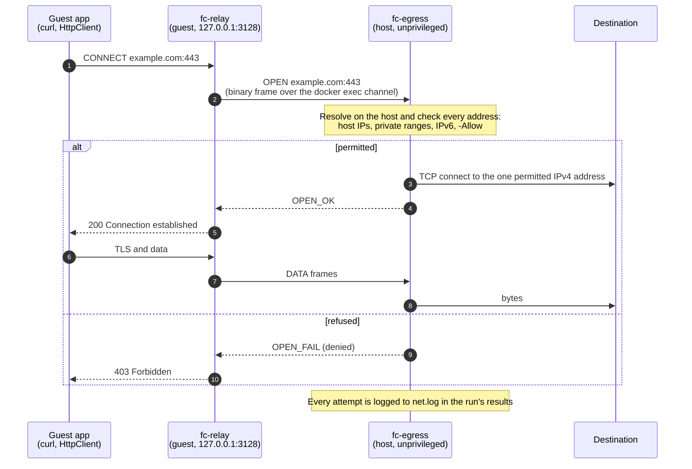
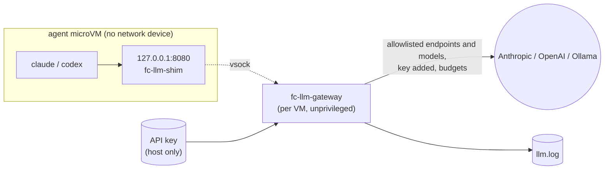

# Firecracker Security Sandbox

Disposable, hardware-isolated microVMs on Windows 11 built for security testing: detonating untrusted samples with no network at all, or running scanners and exploit tooling with tightly controlled outbound access. Supports both **Linux guests** (jailed [Firecracker](https://firecracker-microvm.github.io/) microVMs through WSL2) and **Windows guests** (Hyper-V Utility VMs running [Nano Server 2025 (`malaker/nanoserver`)](https://github.com/malaker/nanoserver) with 32-bit WoW64, COM STA & Win32 message-queue shims, IIS 10, .NET 10, and .NET Framework 4.8.1). Everything is driven from PowerShell.



## Features

- **One-command setup.** For Linux guests, a dedicated WSL2 distro is created and provisioned with pinned, checksum-verified Firecracker, guest kernel and root filesystem. For Windows guests, Windows Hyper-V/Containers features, the container runtime (`docker` or experimental `containerd`+`runhcs-v1`), the Nano Server base image and the networked-mode egress proxy are provisioned. Re-running setup is safe and repairs only what is missing.
- **Disposable VMs.** Every VM boots from a fresh copy or ephemeral scratch layer of the base image and is destroyed after use, so nothing a test changes survives.
- **Defence in depth.** Each Linux VM runs under the Firecracker jailer: its own chroot, an unprivileged uid and cgroup CPU/memory limits. Each Windows VM runs with `--isolation=hyperv` inside a dedicated Hyper-V Utility VM (`vmwp.exe`) with its own Windows kernel, and transfers files via tar over HVSocket rather than mounting a writable host folder.
- **Hard timeouts.** A detached watchdog enforces every VM's lifetime, even if the controller crashes.
- **Two network modes.** `isolated` has no network device at all. `networked` has controlled egress with the host and private ranges blocked, plus an optional destination allowlist: NAT-ed through nftables for Linux guests, and through a host-side egress proxy for Windows guests, which still have no network adapter.
- **Simple results.** Each run's exit code, stdout/stderr, metadata and output files are collected into `runs\<run-id>\` on Windows.
- **Agents in the sandbox.** Run Claude Code or Codex (OpenAI or a local Ollama) inside a Linux microVM with a task prompt, to analyse a payload or probe the sandbox from the inside. In the default gateway mode the VM has no network and the API key stays on the host. See [Agents in the sandbox](#agents-in-the-sandbox--agent).
- **Guest output airlock.** Output files never reach the host by unpacking a guest's archive: a fresh airlock VM validates and re-encodes them, and the host checks the result again without admin rights before writing anything. Links, devices, unsafe names and oversized output are refused. See [Guest output airlock](#guest-output-airlock).

## Requirements

- Windows 11 with a CPU that has hardware virtualization (Intel VT-x or AMD-V) enabled in firmware
- **For `-Guest linux` (default):** WSL 2 (a recent version that supports `wsl --install <distro> --name`) and WSL2 nested virtualization (on by default on Windows 11; setup offers to enable it if needed)
- **For `-Guest windows`:** An elevated (Administrator) PowerShell prompt, plus the Windows `Microsoft-Hyper-V` and `Containers` optional features (setup offers to enable them if needed)
- **The [.NET 10 SDK](https://dotnet.microsoft.com/download/dotnet/10.0)** (**breaking change:** earlier versions needed it only for Windows networked mode), used by setup to build the guest output airlock tool (`fc-airlock`) and the MCP server (`fc-mcp.exe`). Linux and Windows setup both fail without it, because run output is collected through the airlock. For `-Guest windows -Net networked` it also builds the egress proxy (`fc-egress.exe`) and the guest relay (`fc-relay.exe`).
- About 6 GB of free disk space and internet access during setup

Tested with Windows 11 build 26200, WSL 2.6.3 (kernel 6.6.87), Firecracker v1.17.0, and Nano Server 2025 (`ltsc2025`).

VirtualBox is not supported. When Hyper-V is active (as it is whenever WSL2 or Hyper-V Utility VMs run), VirtualBox cannot expose nested VT-x to its guests, so Firecracker cannot start inside them.

## Quick start

From the repository root in PowerShell:

### Linux microVM (default)

```powershell
.\fc.ps1 setup                                            # once; safe to re-run
.\fc.ps1 run -Payload .\samples\hello -Cmd 'sh ./in/hello.sh'
Get-ChildItem .\runs                                      # results, one folder per run
```

The run streams the guest's output and exits with the guest command's exit code. The expected output includes `Hello from fc-guest` and `Network interfaces: lo` (isolated mode: no network), and the result folder contains `out\whoami.txt`.

### Windows Nano Server microVM (`-Guest windows`, elevated PowerShell)

```powershell
.\fc.ps1 setup -Guest windows -ImageRepo adaskothebeast/nanoserver   # once; pulls adaskothebeast/nanoserver:aspnet-x86
.\fc.ps1 run -Guest windows -Payload .\samples\hello-win -Cmd '.\in\hello.cmd'
Get-ChildItem .\runs                                      # results, one folder per run
```

The default image repository, `malaker/nanoserver`, is not published on Docker Hub yet, so a plain `.\fc.ps1 setup -Guest windows` fails at the image pull. Either pull the upstream images with `-ImageRepo adaskothebeast/nanoserver` (setup remembers the choice), or build the images locally with `-BuildFromSource` (see [Windows Nano Server setup](#windows-nano-server-setup-fcps1-setup--guest-windows-options)).

## Setup

### Linux setup (`.\fc.ps1 setup [-Yes]`)

`.\fc.ps1 setup [-Yes]` performs the following steps, skipping any that are already complete:

1. Creates the WSL distro `fc-host` (Ubuntu 24.04). Other distros are not modified.
2. Ensures `/dev/kvm` is available in it. If nested virtualization is off, setup offers to add `nestedVirtualization=true` under `[wsl2]` in `%USERPROFILE%\.wslconfig` (keeping a `.wslconfig.bak` backup) and to run `wsl --shutdown`. That restarts **all** WSL distros, including those used by Podman or Docker Desktop. Setup asks for confirmation unless `-Yes` is given. Declining leaves the system unchanged and exits with code 1.
3. Runs `host/provision.sh` inside `fc-host`, which:
   - installs the required packages and downloads the pinned Firecracker/jailer release, guest kernel and Ubuntu image (versions and SHA-256 sums are in [host/versions.env](host/versions.env)). A checksum mismatch stops setup and names the file.
   - builds the base disk image, generates the controller's SSH key, enables IP forwarding and creates the nftables table.
   - installs the controller into `/opt/fc-sandbox`.
4. Runs `.\fc.ps1 doctor`.

A repeated run downloads nothing and reports `all components are up to date`. After changing anything under `host/` or `images/`, re-run setup to copy the updated controller into the distro.

### Windows Nano Server setup (`.\fc.ps1 setup -Guest windows [options]`)

```powershell
# Default: standalone Windows Docker Engine + pull malaker/nanoserver:aspnet-x86
.\fc.ps1 setup -Guest windows

# Custom image repository or flavour (e.g. adaskothebeast/nanoserver or iis-netfx-x86)
.\fc.ps1 setup -Guest windows -ImageRepo adaskothebeast/nanoserver -Flavour iis-netfx-x86

# Build locally from .\externalimages (or a junction to C:\sources\nanoserver)
cmd /c mklink /J .\externalimages C:\sources\nanoserver
.\fc.ps1 setup -Guest windows -Flavour aspnet-x86 -BuildFromSource

# ...or point -SourceDir at the nanoserver source tree directly
.\fc.ps1 setup -Guest windows -BuildFromSource -SourceDir C:\sources\nanoserver

# Pin the Nano Server base build (e.g. when DISM fails with 0x800F0950 because
# Windows Update has no Features on Demand content for the newest ltsc2025 build yet)
.\fc.ps1 setup -Guest windows -BuildFromSource -NanoBase mcr.microsoft.com/windows/nanoserver:10.0.26100.33650
```

1. Checks that Windows `Microsoft-Hyper-V` and `Containers` optional features are enabled (asking for confirmation before enabling or requiring a reboot unless `-Yes` is passed).
2. Installs and starts the selected `-WinRuntime` (`docker` standalone Moby engine by default, or experimental `containerd` + `nerdctl` + `containerd-shim-runhcs-v1`), verifying SHA-256 checksums against [windows/versions.psd1](windows/versions.psd1).
3. Saves the selected runtime, image repository, and default flavour in `C:\ProgramData\fc-sandbox-win\config.json`.
4. Pulls `<ImageRepo>:<Flavour>` (or builds `<Flavour>` locally from `./externalimages` when `-BuildFromSource` is passed).
5. Builds the networked-mode egress binaries from [windows/egress](windows/egress) with the .NET 10 SDK into `C:\ProgramData\fc-sandbox-win\bin\egress\` (`host\fc-egress.exe`, `guest\fc-relay.exe`). It skips the build when they are newer than the sources, and warns without failing when no .NET 10 SDK is installed.
6. Runs `.\fc.ps1 doctor -Guest windows`, which reports whether the egress binaries are present.

### Checking the host

```powershell
.\fc.ps1 doctor                        # Linux preflight, PASS/FAIL with a hint; exit 0 only if all pass
.\fc.ps1 doctor -Boot                  # additionally boots a small Linux VM and runs a command in it
.\fc.ps1 doctor -Guest windows         # Windows Hyper-V / runtime / image preflight checks
.\fc.ps1 doctor -Guest windows -Boot   # additionally boots a Hyper-V Utility VM and runs a command over HVSocket
```

### Uninstalling

```powershell
# Linux backend
wsl --unregister fc-host                         # deletes the distro and everything in it
# only if setup added it: restore %USERPROFILE%\.wslconfig from .wslconfig.bak (or remove the nestedVirtualization line)
Remove-Item -Recurse .\runs

# Windows backend (in an elevated PowerShell prompt)
.\fc.ps1 cleanup -Guest windows
Stop-Service docker, containerd -ErrorAction SilentlyContinue
& C:\ProgramData\fc-sandbox-win\bin\dockerd.exe --unregister-service   # only if setup registered the docker service
Remove-Item -Recurse -Force C:\ProgramData\fc-sandbox-win -ErrorAction SilentlyContinue
# setup also writes DNS servers into C:\ProgramData\docker\config\daemon.json; remove that file if nothing else uses Docker
```

### containerd backend (`-WinRuntime containerd`, experimental)

`docker` is the default and recommended Windows runtime. `containerd` (containerd + `nerdctl` + `containerd-shim-runhcs-v1`) can be installed alongside it with `.\fc.ps1 setup -Guest windows -WinRuntime containerd`. Any command given `-WinRuntime` uses that runtime, whatever the configured default. The full Windows smoke suite runs against it with `.\tests\smoke-win\all.ps1 -WinRuntime containerd`.

containerd limitations (`.\fc.ps1 doctor -Guest windows -WinRuntime containerd` prints the same list). Requesting one of these with `-WinRuntime containerd` exits 125 before anything is started:

- `-BuildFromSource`: nerdctl builds need BuildKit, which has no supported Windows container builder.

containerd keeps its own image store, so it pulls a second copy of the Nano Server image (several GB) into `C:\ProgramData\containerd`. Setup can only pull images that are published to a registry. An image you built locally with `-BuildFromSource` (always on `docker`) exists only in Docker's store; copy each flavour you need into containerd by hand (elevated), then re-run setup for containerd:

```powershell
$bin = 'C:\ProgramData\fc-sandbox-win\bin'
& $bin\docker.exe save -o "$env:TEMP\nano.tar" malaker/nanoserver:aspnet-x86
& $bin\nerdctl.exe load -i "$env:TEMP\nano.tar"; Remove-Item "$env:TEMP\nano.tar"
```

To remove containerd and keep Docker (elevated):

```powershell
.\fc.ps1 cleanup -Guest windows
Stop-Service containerd
& C:\ProgramData\fc-sandbox-win\bin\containerd.exe --unregister-service
Remove-Item -Force C:\ProgramData\fc-sandbox-win\bin\containerd*.exe, C:\ProgramData\fc-sandbox-win\bin\nerdctl.exe, C:\ProgramData\fc-sandbox-win\bin\ctr.exe -ErrorAction SilentlyContinue
Remove-Item -Recurse -Force C:\ProgramData\containerd
.\fc.ps1 setup -Guest windows -WinRuntime docker    # make docker the default again if needed
```

## Commands

| Command | Description |
|---|---|
| `.\fc.ps1 run -Payload <dir> -Cmd '<command>' [options]` | Boot a VM, copy `<dir>` to `/work/in` (Linux) or `C:\work\in` (Windows), run the command in `/work` or `C:\work`, collect results, destroy the VM |
| `.\fc.ps1 shell [options]` | Boot a VM and open an interactive root / `ContainerAdministrator` shell; the VM is destroyed on exit |
| `.\fc.ps1 start [options]` | Boot a VM in the background and print its run id |
| `.\fc.ps1 ssh <run-id> ['<command>']` | Open a shell in, or run a command in, a started VM |
| `.\fc.ps1 put <run-id> <host-path> [-Dest <guest-dir>]` | Copy a host file, or a folder's contents, into a started VM (default `/work/in`, or `C:\work\in` on Windows) |
| `.\fc.ps1 get <run-id> <guest-path> [-Dest <host-dir>]` | Copy a guest file or folder out of a started VM through the [guest output airlock](#guest-output-airlock) into an empty or new folder (default `runs\<run-id>\files\`). Exits `1` when the airlock refuses the files (links, devices, unsafe names, over the limits) or the guest path does not exist, and writes nothing |
| `.\fc.ps1 mcp [-AllowRoot <dir>[,...]] [-AllowNetworked] [-MaxSessions <n>]` | Run the [MCP server](#mcp-server-fcps1-mcp) over stdio, for an MCP client to launch |
| `.\fc.ps1 list` | List VMs: `running`, `dead` (process gone, e.g. after a WSL/service restart) or `kept`. `ROLE` is `vm`, or `airlock:<run-id>` for an airlock collecting that run's output |
| `.\fc.ps1 stop <run-id>` | Destroy a VM (process, jail/Utility VM, disk copy/container, tap device and firewall rules on Linux, egress proxy on Windows) |
| `.\fc.ps1 cleanup` | Destroy every VM and remove all leftovers, including kept disks and orphans from crashes. Without `-Guest` it covers both backends. Windows VMs can only be destroyed from an elevated prompt; without elevation their state is left untouched and the command fails |
| `.\fc.ps1 doctor [-Boot]` | Run preflight checks |
| `.\fc.ps1 setup [-Yes]` | Create or repair the host |

Options for `run`, `shell`, `start` and `setup`:

| Option | Default | Description |
|---|---|---|
| `-Guest linux\|windows` | `linux` | Guest microVM backend (`linux` Firecracker or `windows` Hyper-V Nano Server) |
| `-Flavour <tag>` | `aspnet-x86` | Windows only: Nano Server flavour (`aspnet-x86`, `aspnet-x64`, `iis-aspnet-x86`, `iis-aspnet-x64`, `iis-netfx-x86`, `iis-netfx-x64`) |
| `-WinRuntime docker\|containerd` | `docker` | Windows only: runtime backend (`docker` or experimental `containerd`+`nerdctl`+`runhcs-v1`) |
| `-ImageRepo <repo>` | `malaker/nanoserver` | Windows only: container repository for Nano Server flavours |
| `-BuildFromSource` | off | Windows `setup` only (requires `-WinRuntime docker`): build the base image locally from `-SourceDir` |
| `-SourceDir <dir>` | `.\externalimages` | Windows `setup -BuildFromSource` only: the nanoserver source tree (the repository root, or a folder containing it as `nanoserver\`) |
| `-NanoBase <image>` | `mcr.microsoft.com/windows/nanoserver:ltsc2025` | Windows `setup -BuildFromSource` only: Nano Server base image passed as the `NANO_BASE` build arg |
| `-Net isolated\|networked` | `isolated` | Network mode (see below) |
| `-Allow <cidr>[,<cidr>...]` | none | Networked mode only: allow egress *only* to these destinations (IPv4 in dotted-quad form, e.g. `203.0.113.0/24` or `1.1.1.1`; octets without leading zeros) |
| `-Vcpu <n>` | 2 | vCPUs (1-32, at most the host's CPU count) |
| `-MemMib <n>` | 1024 | Guest memory in MiB (at least 128; must fit in free host memory) |
| `-Timeout <dur>` | `30m` | Hard lifetime, e.g. `90s`, `10m`, `1h` |
| `-Keep` | off | Keep the VM's disk/container after it stops, for inspection; removed by `stop` or `cleanup` |
| `-Agent claude\|codex\|codex-ollama` | none | `run` and `shell`, Linux only: boot the agent image with that profile (see [Agents in the sandbox](#agents-in-the-sandbox--agent)) |
| `-Prompt '<text>'`, `-PromptFile <file>` | none | Agent `run` only (exactly one): the agent's task |
| `-Model <name>` | the profile's default | Agent only: model to use; must match the profile's model list |
| `-AgentDirect` | off | Agent only: direct mode (networked VM, API key inside the VM) |
| `-AgentTokenBudget <n>` | 2,000,000 | Agent gateway mode only: total tokens the gateway forwards before refusing with `429` |
| `-NoAgentImage` | off | `setup` only: skip building the agent image (about 1 GB of downloads) |
| `-OllamaUrl <url>` | Windows host, port 11434 | `setup` only: Ollama server for the `codex-ollama` profile |

VMs created with `start` are also subject to `-Timeout`.

## Network modes

**isolated** (default): the VM has **no network device**, only loopback. The controller reaches Linux guests over a `virtio-vsock` socket and Windows guests over a Hyper-V `HVSocket` exec channel, so uploads and result collection still work.

**networked** on Linux: the VM gets `eth0` with a private /30 from `172.30.0.0/16` and NAT-ed outbound access through WSL. nftables rules, installed before the VM boots, always block the guest from reaching:

- the WSL host and the Windows host
- other microVMs (`172.30.0.0/16`)
- private, link-local, CGNAT, loopback and multicast ranges (`10/8`, `172.16/12`, `192.168/16`, `169.254/16`, `100.64/10`, `127/8`, `224/4`, `240/4`)
- all IPv6 destinations (`::/0`)

**networked** on Windows: the guest still has **no network adapter**. It reaches the network only through an HTTP proxy at `127.0.0.1:3128` inside the guest (`HTTP_PROXY`/`HTTPS_PROXY` are set for every command, and `machine.config` is updated on the `.NET Framework` flavours). Behind that proxy:

1. **Guest relay:** `fc-relay.exe` parses each proxy request and tunnels the connection over the same HVSocket exec channel used for file transfer.
2. **Host proxy:** `fc-egress.exe` runs as a separate, non-admin, Medium-integrity process. It resolves the destination name on the host, checks every resolved address, and connects only to an address it permitted.
3. **Always blocked:** every Windows host address (all local interfaces, also when allowlisted), private, link-local, CGNAT, loopback, multicast and reserved ranges (`0/8`, `10/8`, `100.64/10`, `127/8`, `169.254/16`, `172.16/12`, `192.0.0/24`, `192.168/16`, `198.18/15`, `224/4`, `240/4`), and all IPv6.
4. **Refusals:** a connection the policy refuses gets `403 Forbidden` from the proxy. A permitted destination that can't be reached gets `502 Bad Gateway`, and more than 64 concurrent connections get `503 Service Unavailable`.
5. **Logging:** every attempt is logged to `runs\<run-id>\net.log`.
6. **Start order:** the proxy is up before any image entrypoint or payload starts. If it can't start, the run fails with exit code `125`.

One proxied connection, permitted or refused:



Only TCP through the proxy works on Windows (HTTP `CONNECT` and plain `http://` requests). Ping, UDP, raw sockets and programs that ignore proxy settings get no network.

With `-Allow`, *only* the listed CIDRs are reachable; private addresses become reachable only when listed explicitly. All other traffic is dropped. On Linux that **includes DNS**: guests resolve names through `1.1.1.1` and `8.8.8.8`, so add `1.1.1.1/32` to the allowlist when a test needs name resolution. On Windows the host resolves names for the proxy, so no resolver needs to be allowlisted. The allowlist is checked against the resolved addresses.

```powershell
.\fc.ps1 run -Payload .\tests -Cmd './in/scan.sh' -Net networked -Allow 203.0.113.0/24,1.1.1.1/32 -Timeout 10m
.\fc.ps1 run -Guest windows -Flavour aspnet-x86 -Payload .\samples\hello-win -Cmd '.\in\hello.cmd' -Net networked -Allow 203.0.113.0/24,1.1.1.1/32 -Timeout 10m
```

> **Note:** traffic from networked VMs leaves through the Windows host, so targets see the host's public or LAN IP address. Use `isolated` mode for untrusted samples.

## Results

Every `run` writes `runs\<run-id>\` (run ids look like `20261027-183001-3461`):

| File | Content |
|---|---|
| `exit_code` | Exit code of the run |
| `stdout.log`, `stderr.log` | Output of the guest command, written as it runs (kept on timeout) |
| `out\` | Everything the command wrote to `/work/out` (Linux) or `C:\work\out` (Windows) in the guest |
| `meta.json` | Run id, command, payload, network mode, allowlist, vCPU, memory, timeout, start/end time, `timed_out`, `error`, `collection` (Linux: how `out\` was collected through the [airlock](#guest-output-airlock)), plus `firecracker` (Linux) or `guest`, `flavour`, `image_repo`, `win_runtime` (Windows). Agent runs add `agent` (see [Agents in the sandbox](#agents-in-the-sandbox--agent)) |
| `llm.log` | Agent runs in gateway mode only: one line per model API call (see [Agent results](#agent-results)) |
| `net.log` | Windows `networked` runs only: one line per connection attempt with `decision` (`allowed`, `denied`, `failed`), `host`, `port`, the resolved `ip`, `reason` and `bytes_up`/`bytes_down` (kept on timeout) |

Exit codes: the guest command's own exit code; **124** when the run hit its timeout; **125** when the sandbox itself failed (boot, upload, missing payload). For commands that can themselves exit with 124 or 125, `timed_out` and `error` in `meta.json` tell the cases apart.

Inside the guest the payload is at `/work/in` (Linux) or `C:\work\in` (Windows) and the working directory is `/work` or `C:\work`, so `-Cmd './in/scan.sh'` (Linux) or `-Cmd '.\in\hello.cmd'` (Windows) runs a script from the payload. Files written to `out/` are copied back. Commands run as `root` (Linux) or `ContainerAdministrator` (Windows). The Linux guest image is a minimal Ubuntu 24.04 with `curl`, `socat`, `iproute2` and `openssh`. The Windows Nano Server 2025 flavours include `curl.exe`, `tar.exe`, 32-bit `SysWOW64` (on `-x86` flavours), `nanoserver_sta_shim.dll`, and `.NET 10` or `.NET Framework 4.8.1`.

## Agents in the sandbox (`-Agent`)

An agent run boots a Linux microVM from the **agent image** and runs the agent headless with a task prompt. The image is the base image plus Node.js, [Claude Code](https://docs.anthropic.com/en/docs/claude-code) and [Codex](https://github.com/openai/codex), pinned in [images/agent/package-lock.json](images/agent/package-lock.json). Use it to have an agent inspect a payload inside the sandbox, or to have it probe the sandbox itself from the inside. Windows guests are not supported (`-Agent` with `-Guest windows` exits `125`).

```powershell
$env:ANTHROPIC_API_KEY = '<key>'      # or put it in %USERPROFILE%\.fc-sandbox\keys\anthropic.key
.\fc.ps1 run -Agent claude -Payload .\samples\hello -Prompt 'Explain what ./in/hello.sh does. Do not run it.'
.\fc.ps1 run -Agent codex -PromptFile .\task.md -Timeout 20m      # OPENAI_API_KEY or keys\openai.key
.\fc.ps1 run -Agent codex-ollama -Prompt 'Map the guest from the inside: users, mounts, devices.'
.\fc.ps1 shell -Agent claude          # interactive: run 'fc-agent interactive', or the client yourself
```

`.\fc.ps1 setup` builds the agent image (about 1 GB of downloads, a 6 GiB sparse image) and the LLM gateway (`fc-llm-gateway`, .NET 10). Skip the image with `-NoAgentImage`. `.\fc.ps1 doctor` reports whether the image and the gateway are there.

**Profiles** ([host/agents/profiles.json](host/agents/profiles.json)):

| Profile | Client | Provider | Default model | Key |
|---|---|---|---|---|
| `claude` | Claude Code | Anthropic API | `claude-opus-5-5` (`claude-*` allowed) | `ANTHROPIC_API_KEY` or `%USERPROFILE%\.fc-sandbox\keys\anthropic.key` |
| `codex` | Codex | OpenAI API | `gpt-5.1-codex-max` (`gpt-*` allowed) | `OPENAI_API_KEY` or `%USERPROFILE%\.fc-sandbox\keys\openai.key` |
| `codex-ollama` | Codex | your Ollama server | `gpt-oss:20b` (any model) | none |

The environment variable wins over the key file, and only the key file's first line is read. `fc.ps1` hands the key to `fc-host` on the stdin of a separate call, never on a command line. The key is deleted when the run ends.

**Ollama:** `codex-ollama` uses the Ollama server on the Windows host (`http://<host>:11434`, as WSL sees it) unless setup was given another one with `.\fc.ps1 setup -OllamaUrl http://<server>:11434`. Ollama must listen on an address WSL can reach (`OLLAMA_HOST=0.0.0.0` on the Windows host). `doctor` warns when it is not reachable.

### Gateway mode (default) and direct mode



**Gateway mode:** the VM is isolated, with no network device. The agent's only way out is a per-VM gateway on the host, reached over vsock at `127.0.0.1:8080` in the guest. The gateway runs as its own unprivileged uid and:

- adds the API key on the way out, so **the key never enters the VM**. The client inside gets a placeholder.
- forwards only the profile's endpoints and models (`403` otherwise).
- refuses requests over 16 MiB (`413`). It stops at 500 requests or at the token budget (`429`). The budget defaults to 2,000,000 tokens; change it with `-AgentTokenBudget`. Responses are capped at 256 MiB and each request at 600 s.
- logs every call to `llm.log`.

**Direct mode (`-AgentDirect`):** the VM is `networked`, with the usual egress rules (`-Allow` works). The agent talks to the provider itself, with no gateway. Use it for tests where the gateway would get in the way, such as checking the client's own network behaviour.

> **Warning:** in direct mode **the API key is inside the VM**, at `/root/.fc-agent/key`. Anything running in the VM can read and exfiltrate it. Use a dedicated, low-limit key and never use direct mode with untrusted payloads. `fc.ps1` prints a warning on every direct-mode run. `codex-ollama` has no direct mode, because the host protection blocks the Ollama server on the host.

### Agent results

Besides the usual files, an agent run writes:

| File | Content |
|---|---|
| `out\agent-transcript.jsonl` | The client's JSON event stream, collected through the [airlock](#guest-output-airlock) like any output |
| `llm.log` | Gateway mode only: one line per API call (`ts= method= path= model= decision= reason= status= bytes_up= bytes_down= tokens_in= tokens_out=`). `decision` is `forwarded`, `refused` or `failed`. Keys are never logged |
| `meta.json` → `agent` | `profile`, `client`, `client_version`, `provider`, `model`, `mode` (`gateway` or `direct`). Gateway mode adds `requests`, `refused` and `tokens` |

The run's exit code is the client's. Inside the guest the prompt is at `/work/.fc/prompt.md`, and the payload, if any, is at `/work/in` as usual.

## MCP server (`fc.ps1 mcp`)

`fc.ps1 mcp` exposes the sandbox to any MCP client (Claude Code, other stdio MCP clients) as tools, so an agent on the host can send risky work (detonating a sample, running an exploit PoC or an untrusted installer) into a disposable VM instead of running it on the host. The server is a policy layer over `fc.ps1`; isolation comes entirely from the backends described above.

**Prerequisites:** the .NET 10 SDK. `.\fc.ps1 setup` builds the server into `%LOCALAPPDATA%\fc-sandbox\mcp\` (and rebuilds it only when its sources change). Without a build, `fc.ps1 mcp` exits `125` with a message on stderr and writes nothing to stdout.

**Register it with Claude Code** (run from the folder whose files the agent may upload, usually your project):

```powershell
claude mcp add fc-sandbox -- powershell.exe -NoProfile -ExecutionPolicy Bypass -File C:\sources\Firecracker\fc.ps1 mcp
```

Any other stdio MCP client takes the same command, for example:

```json
{
  "mcpServers": {
    "fc-sandbox": {
      "command": "powershell.exe",
      "args": ["-NoProfile", "-ExecutionPolicy", "Bypass", "-File", "C:\\sources\\Firecracker\\fc.ps1", "mcp"]
    }
  }
}
```

**Options:**

| Option | Default | Description |
|---|---|---|
| `-AllowRoot <dir>[,...]` | the folder the server starts in | Host folders whose files `sandbox_run` and `sandbox_put` may upload. Paths are resolved through junctions and links first; a payload that contains a link or junction is refused |
| `-AllowNetworked` | off | Allow `net: networked`. Without it every networked request is refused and VMs have no network at all |
| `-MaxSessions <n>` | 4 | Concurrent sessions (1-64) |

**Tools:**

| Tool | Does |
|---|---|
| `sandbox_run` | One-shot run, like `fc.ps1 run`: payload, command and VM options (`guest`, `net`, `allow`, `vcpu`, `mem_mib`, `timeout`, `flavour`). Returns run id, exit code, timeout flag, stdout/stderr, result folder and output files. With `agent` (`claude`, `codex`, `codex-ollama`) and `prompt` instead of `command`, it runs an [agent](#agents-in-the-sandbox--agent) in gateway mode (Linux, isolated, payload optional, `model` to pick the model). The result then also has `agent`, `transcript_path` and `llm_log_path`. Direct mode is not available through MCP. The server takes API keys from its own environment or the key files |
| `sandbox_start` | Start a VM that stays up between calls; returns a session id |
| `sandbox_exec` | Run a command in a session in `/work`; state persists. Full logs go to `runs\<session>\exec\<n>\` |
| `sandbox_put` | Copy a host file or folder (inside the allowed roots) into a session |
| `sandbox_get` | Copy a guest file or folder out through the guest output airlock into `runs\<session>\files\<n>\`; the agent cannot choose the host destination |
| `sandbox_list` | This server's sessions |
| `sandbox_stop` | Destroy a session |

**Rules the server enforces:**

- **Ownership:** session tools act only on VMs this server process started; VMs started from the CLI or by another server are invisible to them.
- **Cleanup:** sessions keep the normal hard timeout (default 30 minutes). When the client disconnects or the server is stopped (Ctrl+C, console closed), the server destroys all its sessions. If the server process is killed outright, the VMs' watchdogs still destroy them at their timeout; `fc.ps1 cleanup` removes them earlier.
- **Bounded, marked output:** each returned stdout/stderr is at most 64 KiB (beginning and end, with a `[... N bytes omitted ...]` marker); the full logs stay in `runs\`. Guest output is stripped of terminal escape sequences and control characters, follows a fixed notice that it is untrusted data, and sits between delimiters that carry a random value per call, so guest output cannot fake the end of its own block.
- **No host-side actions:** the server has no tool that runs a host command, reads host files other than uploads from the allowed roots, or writes outside `runs\`.
- **Windows guests** need the MCP server to run elevated, which means starting the MCP client from an elevated prompt. Otherwise Windows-guest calls are refused.

**Recommended client settings:** guest output is attacker-controlled. Keep the client's own permission prompts on for shell and file-writing tools while working with untrusted samples, and do not let the agent auto-approve host commands suggested by sandbox output.

### Guest output airlock

Files never reach the host by unpacking a guest's archive on the host. Every copy out of a guest (`run`'s `out\` and `get`) goes through a fresh airlock VM of the same guest OS: a Firecracker microVM for Linux guests, a Hyper-V isolated Nano Server VM for Windows guests.

1. The host copies the guest's tar stream as opaque bytes, capped in size while it streams.
2. A new isolated airlock VM (1 vCPU, 256 MiB, 5-minute lifetime) reads the stream as an unprivileged user (`nobody` on Linux, `ContainerUser` on Windows) with `fc-airlock validate`. It accepts only regular files and directories with names that are safe on NTFS (no `..`, absolute paths, `:`, reserved device names such as `con.txt`, trailing dots or spaces, or names that differ only in case), within 1 GiB, 10,000 entries and 1 GiB per file, and re-encodes them as a blob plus a manifest with SHA-256 hashes. The airlock is then destroyed.
3. On the host, `fc-airlock unpack` checks every rule, byte range and hash again and writes into an empty staging folder, without admin or root rights: as a throwaway uid inside `fc-host` for Linux guests, and through `fc-airlock launch-unpack` (a non-admin, Medium-integrity token in a kill-on-close job) for Windows guests, whose controller runs elevated. Only directories and regular files are moved into place, all at once or not at all.

Windows guests: `tar.exe` follows junctions and directory links instead of archiving them, so links in a Windows guest's output are found and refused before the copy starts (`junction or symbolic link is not allowed: './<name>'`).

A refused collection keeps the guest command's exit code, leaves `out\` empty, prints `collection refused: <reason>`, and is recorded in `meta.json` under `collection` (`status` `ok`, `refused` or `failed`, with `reason`, `files` and `bytes`). Runs with no output start no airlock. While a collection runs, `list` shows the airlock with role `airlock:<run-id>`.

## Security considerations and limitations

- **LLM gateway (agent gateway mode):** the gateway is new host code that reads guest data: HTTP requests from the agent VM. It is written in a memory-safe language and runs per VM as an unprivileged uid that only that VM's jail can reach, with limits on headers, sizes and connections. It checks the endpoint and the model, not the request's content. An agent, or a payload that takes the agent over, can send anything it sees to the provider, within the budgets.
- **Data sent to providers:** an agent run sends the prompt to Anthropic, OpenAI or your Ollama server, along with whatever the agent reads in the VM, including payload contents. Use `codex-ollama` with a local server for samples that must not leave your machine.
- **Direct mode puts the API key in the VM** and gives the VM network access. Treat any key used with `-AgentDirect` as exposed.
- **Agents follow instructions in what they read:** a payload can contain text aimed at the agent. Inside the VM that can only misuse the agent's budget and output. Treat its transcript and output as untrusted, like any guest output.
- **MCP server and prompt injection:** a sample's output reaches the host agent through the MCP tools. The server bounds and marks that output and offers no host-side tools, but a marker does not stop a model from following instructions in it; the client's permission settings remain the final control.
- **Elevated MCP clients:** using Windows guests through MCP means running the MCP client elevated, so everything that client does runs with administrator rights. Use a separate elevated client session only for Windows-guest work.
- **Killed MCP server:** if the server process is killed instead of stopped, its sessions keep running until their hard timeout (default 30 minutes; use a shorter `timeout` for agent sessions) or until `fc.ps1 cleanup`.
- **Guest output airlock:** the only host code that reads data derived from guest output is `fc-airlock unpack`. It parses a small manifest (JSON) and copies byte ranges, in a memory-safe language, without admin or root rights, after the riskier archive parsing already ran inside a throwaway airlock VM. An attacker would need to compromise the airlock and then this reader. Each collection with output costs one more VM boot (about 1.5-8 s for Linux, about 3.5-5 s for Windows). The Windows link check before the copy relies on the guest's answer; a guest that hides a link only gets its own files collected, within the limits.
- **Linux (Firecracker + jailer):** Firecracker with the jailer provides strong isolation but is not a guarantee against KVM or Firecracker escape vulnerabilities. A successful escape would land in the `fc-host` WSL VM, which can access Windows drives through `/mnt/c`. For high-risk samples, set `[automount] enabled=false` in `fc-host`'s `/etc/wsl.conf`. Results then stay in `/var/lib/fc-sandbox/results` inside the distro, and `fc.ps1` (which runs scripts from `/mnt/c`) is unavailable until automount is re-enabled.
- **Windows (Hyper-V Utility VM):** Every Windows guest runs with `--isolation=hyperv` inside a dedicated Hyper-V Utility VM (`vmwp.exe`) with its own Windows kernel, and files are streamed in and out via `tar.exe` over `HVSocket` rather than mounting a writable host directory. It does not defend against Hyper-V (`vmwp.exe` / VMBus) escape vulnerabilities. Compared with the Linux path there is one layer fewer (no surrounding WSL VM), and the host components that carry guest exec traffic (`vmcompute.exe`, `dockerd.exe`) run as `SYSTEM`.
- **Windows networked mode is enforced by the egress proxy, not by Windows networking.** Windows 11 accepts HNS endpoint ACLs on NAT networks but doesn't enforce them, and Windows Firewall rules don't reliably filter traffic forwarded from containers. An earlier HNS-based design let guests reach the LAN and host services. The proxy is the only new host code that reads guest data: it parses fixed-size binary frames (no HTTP), limits frame size, stream count and idle time, and runs without admin rights. It sees only TCP connection requests, not traffic inside TLS.
- **Administrator requirement on Windows:** Running `-Guest windows` commands requires an elevated (Administrator) PowerShell prompt because the Windows Docker engine named pipe is administrator-only. The egress proxy drops those rights before it handles any guest data.
- **Experimental `containerd` backend on Windows:** `-WinRuntime docker` is the default and recommended backend. `-WinRuntime containerd` is experimental; see [containerd backend](#containerd-backend--winruntime-containerd-experimental) for what it does not support.
- **WSL lifecycle (`-Guest linux`):** Linux VMs run inside WSL. `wsl --shutdown`, or Windows stopping WSL, terminates them; `list` then shows them as `dead` and `cleanup` removes the leftovers.
- **Startup and disk overhead:** Each Linux VM receives a full sparse copy of the 2 GiB base image (about 1-2 seconds), and nested virtualization is slower than bare metal. Each Windows VM creates an ephemeral Hyper-V container scratch layer (`sandbox.vhdx`).
- **Shared WSL2 network namespace (`-Guest linux`):** All WSL2 distros share one network namespace. The `inet fc_sandbox` nftables table matches only `fc-tap-*` interfaces and `172.30.0.0/16`, so other distros are unaffected; avoid using `172.30.0.0/16` elsewhere.
- **Controller SSH key (`-Guest linux`):** The Linux controller connects to guests with host-key checking disabled. The channel is a root-owned local Unix socket and every guest boots from the same fresh image; the controller key should not be reused elsewhere.
- **Upgrading Linux artifacts:** The Linux guest kernel and root filesystem come from Firecracker's public CI artifacts (the v1.15 set, the newest published). To upgrade, update [host/versions.env](host/versions.env), including the checksums, and re-run setup.

## Development

Run the end-to-end smoke tests from the repository root:

```powershell
# Linux Firecracker smoke tests (inside fc-host as root, about 5 minutes)
wsl -d fc-host -u root -e bash /mnt/c/sources/Firecracker/tests/smoke/all.sh

# Windows Nano Server microVM smoke tests (in an elevated PowerShell prompt)
powershell -NoProfile -ExecutionPolicy Bypass -File .\tests\smoke-win\all.ps1
# ...against the containerd backend instead of docker (installs it alongside docker if needed)
powershell -NoProfile -ExecutionPolicy Bypass -File .\tests\smoke-win\all.ps1 -WinRuntime containerd

# Egress proxy / relay unit and integration tests (no VM or elevation needed; .NET 10 SDK)
dotnet test windows\egress

# Guest output airlock tool unit tests
dotnet test airlock

# LLM gateway unit tests (no VM needed)
dotnet test gateway

# MCP server unit tests; FC_MCP_INTEGRATION=1 also runs the tools against real Linux VMs
# (including an agent run against the local fake provider)
dotnet test mcp
$env:FC_MCP_INTEGRATION = '1'; dotnet test mcp

# MCP server end to end over stdio (add -Guest windows in an elevated prompt)
powershell -NoProfile -ExecutionPolicy Bypass -File .\tests\smoke-mcp\mcp.ps1
```

The Linux suite must run inside the provisioned `fc-host` distro as root. It checks that first: anywhere else (Git Bash, another distro, a non-root user, or before `.\fc.ps1 setup`) it lists what is missing and exits 125 without reporting any check results. A single part, such as `tests/smoke/net.sh`, can be run the same way. The suite tests the controller installed in `/opt/fc-sandbox`, so after changing anything under `host\`, re-run `.\fc.ps1 setup` before testing.

The Windows suite and each of its parts (`net-isolated.ps1`, `lifecycle.ps1`, `net-protect.ps1`) take `-WinRuntime docker|containerd`, default `docker`, and run every command against that backend. `all.ps1` runs `setup` for the selected runtime, which changes the host's default runtime, image repository and flavour; it restores the previous `config.json` when it finishes, passes or fails. If the suite process is killed outright, re-run `.\fc.ps1 setup -Guest windows -WinRuntime docker` to reset the default.

The agent tests (`tests/smoke/agents.sh`, part of `all.sh`, and the MCP tests) use a local fake provider ([tests/smoke/fake-provider.py](tests/smoke/fake-provider.py)), so they need no API keys. The one exception is a direct-mode check that sends an invalid key to the real Anthropic API.

After changing anything under `windows\egress`, re-run `.\fc.ps1 setup -Guest windows`: VMs use the binaries it publishes to `C:\ProgramData\fc-sandbox-win\bin\egress\`, not the ones in the repository's build folders.

Repository layout:

| Path | Purpose |
|---|---|
| [fc.ps1](fc.ps1) | Unified Windows entry point (`-Guest linux\|windows`) |
| [windows/setup-host.ps1](windows/setup-host.ps1) | Creates and configures the `fc-host` WSL2 distro |
| [windows/setup-nanoserver.ps1](windows/setup-nanoserver.ps1) | Configures Windows Hyper-V features, runtime (`docker`/`containerd`), and Nano Server image |
| [windows/fcctl-win.ps1](windows/fcctl-win.ps1), [windows/lib/](windows/lib/) | Windows Hyper-V microVM controller and runtime/network/state/doctor libraries |
| [windows/versions.psd1](windows/versions.psd1) | Pinned Windows runtime versions, URLs, SHA-256 sums, and default image repo |
| [windows/egress/](windows/egress/) | Networked-mode egress: host proxy `fc-egress` (`FcEgress`), guest relay `fc-relay` (`FcRelay`), shared protocol and policy (`FcEgress.Core`) and tests (`FcEgress.Tests`) |
| [host/provision.sh](host/provision.sh) | Provisions the Linux distro (packages, binaries, images, controller) |
| [host/bin/fcctl](host/bin/fcctl), [host/lib/](host/lib/) | Linux-side controller |
| [images/build-rootfs.sh](images/build-rootfs.sh) | Builds the base Linux guest image |
| [images/build-agent-rootfs.sh](images/build-agent-rootfs.sh), [images/agent/](images/agent/) | Builds the agent image (Node.js, Claude Code, Codex, the `fc-agent` wrapper) |
| [gateway/](gateway/) | LLM gateway `fc-llm-gateway` (`FcGateway`) and tests |
| [host/agents/profiles.json](host/agents/profiles.json), [host/lib/agent.sh](host/lib/agent.sh) | Agent profiles and the controller's agent and gateway handling |
| [samples/hello/](samples/hello/), [samples/hello-win/](samples/hello-win/) | Sample payloads for Linux and Windows guests |
| [tests/smoke/](tests/smoke/), [tests/smoke-win/](tests/smoke-win/) | End-to-end smoke tests for Linux and Windows microVMs |
| [openspec/](openspec/) | Specifications and design/planning documents |

The PowerShell scripts are not signed. A `git clone` runs as-is under the default `RemoteSigned` execution policy. If you downloaded the repository as a ZIP, Windows marks the files as coming from the internet and `RemoteSigned` blocks them: unblock them once with `Get-ChildItem -Recurse | Unblock-File`, or run with `-ExecutionPolicy Bypass`. Hosts that enforce `AllSigned` must sign the scripts with their own certificate. [.gitattributes](.gitattributes) stores `*.ps1` byte-for-byte (`-text`), so git never converts their line endings.

## Responsible use

This project is intended for authorised security testing, malware analysis and research. Only test systems you own or have explicit permission to test.

## License

[MIT](LICENSE) © 2026 Krzysztof Balcerowski
