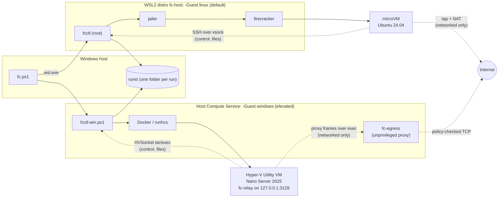
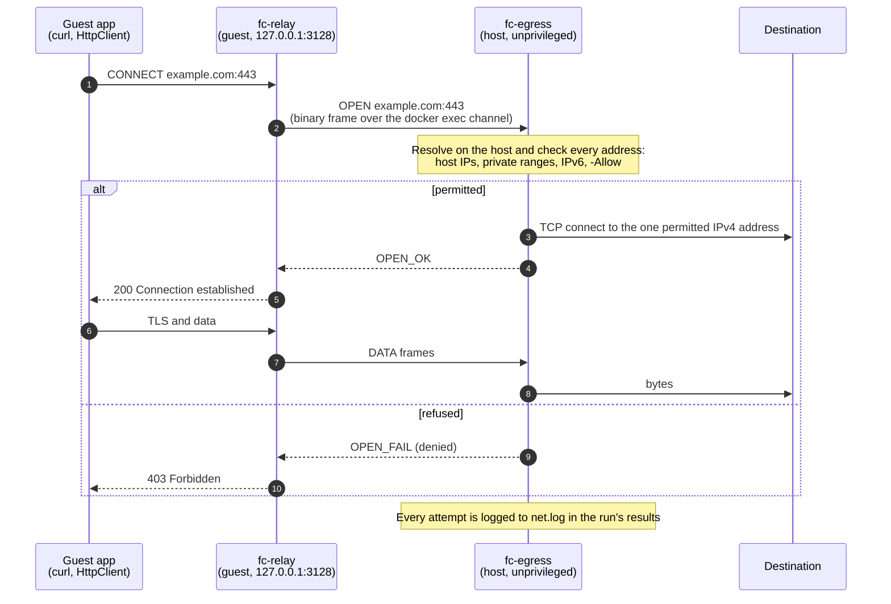

# Firecracker Security Sandbox

Disposable, hardware-isolated microVMs on Windows 11 built for security testing: detonating untrusted samples with no network at all, or running scanners and exploit tooling with tightly controlled outbound access. Supports both **Linux guests** (jailed [Firecracker](https://firecracker-microvm.github.io/) microVMs through WSL2) and **Windows guests** (Hyper-V Utility VMs running [Nano Server 2025 (`malaker/nanoserver`)](https://github.com/malaker/nanoserver) with 32-bit WoW64, COM STA & Win32 message-queue shims, IIS 10, .NET 10, and .NET Framework 4.8.1). Everything is driven from PowerShell.



## Features

- **One-command setup.** For Linux guests, a dedicated WSL2 distro is created and provisioned with pinned, checksum-verified Firecracker, guest kernel and root filesystem. For Windows guests, Windows Hyper-V/Containers features, the container runtime (`docker` or experimental `containerd`+`runhcs-v1`), the Nano Server base image and the networked-mode egress proxy are provisioned. Re-running setup is safe and repairs only what is missing.
- **Disposable VMs.** Every VM boots from a fresh copy or ephemeral scratch layer of the base image and is destroyed after use, so nothing a test changes survives.
- **Defence in depth.** Each Linux VM runs under the Firecracker jailer: its own chroot, an unprivileged uid and cgroup CPU/memory limits. Each Windows VM runs with `--isolation=hyperv` inside a dedicated Hyper-V Utility VM (`vmwp.exe`) with its own Windows kernel, and transfers files via tar over HVSocket rather than mounting a writable host folder.
- **Hard timeouts.** A detached watchdog enforces every VM's lifetime, even if the controller crashes.
- **Two network modes.** `isolated` has no network device at all. `networked` has controlled egress with the host and private ranges blocked, plus an optional destination allowlist: NAT-ed through nftables for Linux guests, and through a host-side egress proxy for Windows guests, which still have no network adapter.
- **Simple results.** Each run's exit code, stdout/stderr, metadata and output files are collected into `runs\<run-id>\` on Windows.

## Requirements

- Windows 11 with a CPU that has hardware virtualization (Intel VT-x or AMD-V) enabled in firmware
- **For `-Guest linux` (default):** WSL 2 (a recent version that supports `wsl --install <distro> --name`) and WSL2 nested virtualization (on by default on Windows 11; setup offers to enable it if needed)
- **For `-Guest windows`:** An elevated (Administrator) PowerShell prompt, plus the Windows `Microsoft-Hyper-V` and `Containers` optional features (setup offers to enable them if needed)
- **For `-Guest windows -Net networked`:** the [.NET 10 SDK](https://dotnet.microsoft.com/download/dotnet/10.0), used by setup to build the egress proxy (`fc-egress.exe`) and the guest relay (`fc-relay.exe`). Without it, setup warns and only `-Net isolated` works.
- About 6 GB of free disk space and internet access during setup

Tested with Windows 11 build 26200, WSL 2.6.3 (kernel 6.6.87), Firecracker v1.17.0, and Nano Server 2025 (`ltsc2025`).

VirtualBox is not supported. When Hyper-V is active (as it is whenever WSL2 or Hyper-V Utility VMs run), VirtualBox cannot expose nested VT-x to its guests, so Firecracker cannot start inside them.

## Quick start

From the repository root in PowerShell:

### Linux microVM (default)

```powershell
.\fc.ps1 setup                                            # once; safe to re-run
.\fc.ps1 run -Payload .\samples\hello -Cmd 'sh ./in/hello.sh'
Get-ChildItem .\runs                                      # results, one folder per run
```

The run streams the guest's output and exits with the guest command's exit code. The expected output includes `Hello from fc-guest` and `Network interfaces: lo` (isolated mode: no network), and the result folder contains `out\whoami.txt`.

### Windows Nano Server microVM (`-Guest windows`, elevated PowerShell)

```powershell
.\fc.ps1 setup -Guest windows -ImageRepo adaskothebeast/nanoserver   # once; pulls adaskothebeast/nanoserver:aspnet-x86
.\fc.ps1 run -Guest windows -Payload .\samples\hello-win -Cmd '.\in\hello.cmd'
Get-ChildItem .\runs                                      # results, one folder per run
```

The default image repository, `malaker/nanoserver`, is not published on Docker Hub yet, so a plain `.\fc.ps1 setup -Guest windows` fails at the image pull. Either pull the upstream images with `-ImageRepo adaskothebeast/nanoserver` (setup remembers the choice), or build the images locally with `-BuildFromSource` (see [Windows Nano Server setup](#windows-nano-server-setup-fcps1-setup--guest-windows-options)).

## Setup

### Linux setup (`.\fc.ps1 setup [-Yes]`)

`.\fc.ps1 setup [-Yes]` performs the following steps, skipping any that are already complete:

1. Creates the WSL distro `fc-host` (Ubuntu 24.04). Other distros are not modified.
2. Ensures `/dev/kvm` is available in it. If nested virtualization is off, setup offers to add `nestedVirtualization=true` under `[wsl2]` in `%USERPROFILE%\.wslconfig` (keeping a `.wslconfig.bak` backup) and to run `wsl --shutdown`. That restarts **all** WSL distros, including those used by Podman or Docker Desktop. Setup asks for confirmation unless `-Yes` is given. Declining leaves the system unchanged and exits with code 1.
3. Runs `host/provision.sh` inside `fc-host`, which:
   - installs the required packages and downloads the pinned Firecracker/jailer release, guest kernel and Ubuntu image (versions and SHA-256 sums are in [host/versions.env](host/versions.env)). A checksum mismatch stops setup and names the file.
   - builds the base disk image, generates the controller's SSH key, enables IP forwarding and creates the nftables table.
   - installs the controller into `/opt/fc-sandbox`.
4. Runs `.\fc.ps1 doctor`.

A repeated run downloads nothing and reports `all components are up to date`. After changing anything under `host/` or `images/`, re-run setup to copy the updated controller into the distro.

### Windows Nano Server setup (`.\fc.ps1 setup -Guest windows [options]`)

```powershell
# Default: standalone Windows Docker Engine + pull malaker/nanoserver:aspnet-x86
.\fc.ps1 setup -Guest windows

# Custom image repository or flavour (e.g. adaskothebeast/nanoserver or iis-netfx-x86)
.\fc.ps1 setup -Guest windows -ImageRepo adaskothebeast/nanoserver -Flavour iis-netfx-x86

# Build locally from .\externalimages (or a junction to C:\sources\nanoserver)
cmd /c mklink /J .\externalimages C:\sources\nanoserver
.\fc.ps1 setup -Guest windows -Flavour aspnet-x86 -BuildFromSource

# ...or point -SourceDir at the nanoserver source tree directly
.\fc.ps1 setup -Guest windows -BuildFromSource -SourceDir C:\sources\nanoserver

# Pin the Nano Server base build (e.g. when DISM fails with 0x800F0950 because
# Windows Update has no Features on Demand content for the newest ltsc2025 build yet)
.\fc.ps1 setup -Guest windows -BuildFromSource -NanoBase mcr.microsoft.com/windows/nanoserver:10.0.26100.33650
```

1. Checks that Windows `Microsoft-Hyper-V` and `Containers` optional features are enabled (asking for confirmation before enabling or requiring a reboot unless `-Yes` is passed).
2. Installs and starts the selected `-WinRuntime` (`docker` standalone Moby engine by default, or experimental `containerd` + `nerdctl` + `containerd-shim-runhcs-v1`), verifying SHA-256 checksums against [windows/versions.psd1](windows/versions.psd1).
3. Saves the selected runtime, image repository, and default flavour in `C:\ProgramData\fc-sandbox-win\config.json`.
4. Pulls `<ImageRepo>:<Flavour>` (or builds `<Flavour>` locally from `./externalimages` when `-BuildFromSource` is passed).
5. Builds the networked-mode egress binaries from [windows/egress](windows/egress) with the .NET 10 SDK into `C:\ProgramData\fc-sandbox-win\bin\egress\` (`host\fc-egress.exe`, `guest\fc-relay.exe`). It skips the build when they are newer than the sources, and warns without failing when no .NET 10 SDK is installed.
6. Runs `.\fc.ps1 doctor -Guest windows`, which reports whether the egress binaries are present.

### Checking the host

```powershell
.\fc.ps1 doctor                        # Linux preflight, PASS/FAIL with a hint; exit 0 only if all pass
.\fc.ps1 doctor -Boot                  # additionally boots a small Linux VM and runs a command in it
.\fc.ps1 doctor -Guest windows         # Windows Hyper-V / runtime / image preflight checks
.\fc.ps1 doctor -Guest windows -Boot   # additionally boots a Hyper-V Utility VM and runs a command over HVSocket
```

### Uninstalling

```powershell
# Linux backend
wsl --unregister fc-host                         # deletes the distro and everything in it
# only if setup added it: restore %USERPROFILE%\.wslconfig from .wslconfig.bak (or remove the nestedVirtualization line)
Remove-Item -Recurse .\runs

# Windows backend (in an elevated PowerShell prompt)
.\fc.ps1 cleanup -Guest windows
Stop-Service docker, containerd -ErrorAction SilentlyContinue
& C:\ProgramData\fc-sandbox-win\bin\dockerd.exe --unregister-service   # only if setup registered the docker service
Remove-Item -Recurse -Force C:\ProgramData\fc-sandbox-win -ErrorAction SilentlyContinue
# setup also writes DNS servers into C:\ProgramData\docker\config\daemon.json; remove that file if nothing else uses Docker
```

## Commands

| Command | Description |
|---|---|
| `.\fc.ps1 run -Payload <dir> -Cmd '<command>' [options]` | Boot a VM, copy `<dir>` to `/work/in` (Linux) or `C:\work\in` (Windows), run the command in `/work` or `C:\work`, collect results, destroy the VM |
| `.\fc.ps1 shell [options]` | Boot a VM and open an interactive root / `ContainerAdministrator` shell; the VM is destroyed on exit |
| `.\fc.ps1 start [options]` | Boot a VM in the background and print its run id |
| `.\fc.ps1 ssh <run-id> ['<command>']` | Open a shell in, or run a command in, a started VM |
| `.\fc.ps1 list` | List VMs: `running`, `dead` (process gone, e.g. after a WSL/service restart) or `kept` |
| `.\fc.ps1 stop <run-id>` | Destroy a VM (process, jail/Utility VM, disk copy/container, tap device and firewall rules on Linux, egress proxy on Windows) |
| `.\fc.ps1 cleanup` | Destroy every VM and remove all leftovers, including kept disks and orphans from crashes. Without `-Guest` it covers both backends. Windows VMs can only be destroyed from an elevated prompt; without elevation their state is left untouched and the command fails |
| `.\fc.ps1 doctor [-Boot]` | Run preflight checks |
| `.\fc.ps1 setup [-Yes]` | Create or repair the host |

Options for `run`, `shell`, `start` and `setup`:

| Option | Default | Description |
|---|---|---|
| `-Guest linux\|windows` | `linux` | Guest microVM backend (`linux` Firecracker or `windows` Hyper-V Nano Server) |
| `-Flavour <tag>` | `aspnet-x86` | Windows only: Nano Server flavour (`aspnet-x86`, `aspnet-x64`, `iis-aspnet-x86`, `iis-aspnet-x64`, `iis-netfx-x86`, `iis-netfx-x64`) |
| `-WinRuntime docker\|containerd` | `docker` | Windows only: runtime backend (`docker` or experimental `containerd`+`nerdctl`+`runhcs-v1`) |
| `-ImageRepo <repo>` | `malaker/nanoserver` | Windows only: container repository for Nano Server flavours |
| `-BuildFromSource` | off | Windows `setup` only (requires `-WinRuntime docker`): build the base image locally from `-SourceDir` |
| `-SourceDir <dir>` | `.\externalimages` | Windows `setup -BuildFromSource` only: the nanoserver source tree (the repository root, or a folder containing it as `nanoserver\`) |
| `-NanoBase <image>` | `mcr.microsoft.com/windows/nanoserver:ltsc2025` | Windows `setup -BuildFromSource` only: Nano Server base image passed as the `NANO_BASE` build arg |
| `-Net isolated\|networked` | `isolated` | Network mode (see below) |
| `-Allow <cidr>[,<cidr>...]` | none | Networked mode only: allow egress *only* to these destinations (IPv4 in dotted-quad form, e.g. `203.0.113.0/24` or `1.1.1.1`; octets without leading zeros) |
| `-Vcpu <n>` | 2 | vCPUs (1-32, at most the host's CPU count) |
| `-MemMib <n>` | 1024 | Guest memory in MiB (at least 128; must fit in free host memory) |
| `-Timeout <dur>` | `30m` | Hard lifetime, e.g. `90s`, `10m`, `1h` |
| `-Keep` | off | Keep the VM's disk/container after it stops, for inspection; removed by `stop` or `cleanup` |

VMs created with `start` are also subject to `-Timeout`.

## Network modes

**isolated** (default): the VM has **no network device**, only loopback. The controller reaches Linux guests over a `virtio-vsock` socket and Windows guests over a Hyper-V `HVSocket` exec channel, so uploads and result collection still work.

**networked** on Linux: the VM gets `eth0` with a private /30 from `172.30.0.0/16` and NAT-ed outbound access through WSL. nftables rules, installed before the VM boots, always block the guest from reaching:

- the WSL host and the Windows host
- other microVMs (`172.30.0.0/16`)
- private, link-local, CGNAT, loopback and multicast ranges (`10/8`, `172.16/12`, `192.168/16`, `169.254/16`, `100.64/10`, `127/8`, `224/4`, `240/4`)
- all IPv6 destinations (`::/0`)

**networked** on Windows: the guest still has **no network adapter**. It reaches the network only through an HTTP proxy at `127.0.0.1:3128` inside the guest (`HTTP_PROXY`/`HTTPS_PROXY` are set for every command, and `machine.config` is updated on the `.NET Framework` flavours). Behind that proxy:

1. **Guest relay:** `fc-relay.exe` parses each proxy request and tunnels the connection over the same HVSocket exec channel used for file transfer.
2. **Host proxy:** `fc-egress.exe` runs as a separate, non-admin, Medium-integrity process. It resolves the destination name on the host, checks every resolved address, and connects only to an address it permitted.
3. **Always blocked:** every Windows host address (all local interfaces, also when allowlisted), private, link-local, CGNAT, loopback, multicast and reserved ranges (`0/8`, `10/8`, `100.64/10`, `127/8`, `169.254/16`, `172.16/12`, `192.0.0/24`, `192.168/16`, `198.18/15`, `224/4`, `240/4`), and all IPv6.
4. **Refusals:** a connection the policy refuses gets `403 Forbidden` from the proxy. A permitted destination that can't be reached gets `502 Bad Gateway`, and more than 64 concurrent connections get `503 Service Unavailable`.
5. **Logging:** every attempt is logged to `runs\<run-id>\net.log`.
6. **Start order:** the proxy is up before any image entrypoint or payload starts. If it can't start, the run fails with exit code `125`.

One proxied connection, permitted or refused:



Only TCP through the proxy works on Windows (HTTP `CONNECT` and plain `http://` requests). Ping, UDP, raw sockets and programs that ignore proxy settings get no network.

With `-Allow`, *only* the listed CIDRs are reachable; private addresses become reachable only when listed explicitly. All other traffic is dropped. On Linux that **includes DNS**: guests resolve names through `1.1.1.1` and `8.8.8.8`, so add `1.1.1.1/32` to the allowlist when a test needs name resolution. On Windows the host resolves names for the proxy, so no resolver needs to be allowlisted. The allowlist is checked against the resolved addresses.

```powershell
.\fc.ps1 run -Payload .\tests -Cmd './in/scan.sh' -Net networked -Allow 203.0.113.0/24,1.1.1.1/32 -Timeout 10m
.\fc.ps1 run -Guest windows -Flavour aspnet-x86 -Payload .\samples\hello-win -Cmd '.\in\hello.cmd' -Net networked -Allow 203.0.113.0/24,1.1.1.1/32 -Timeout 10m
```

> **Note:** traffic from networked VMs leaves through the Windows host, so targets see the host's public or LAN IP address. Use `isolated` mode for untrusted samples.

## Results

Every `run` writes `runs\<run-id>\` (run ids look like `20261027-183001-3461`):

| File | Content |
|---|---|
| `exit_code` | Exit code of the run |
| `stdout.log`, `stderr.log` | Output of the guest command, written as it runs (kept on timeout) |
| `out\` | Everything the command wrote to `/work/out` (Linux) or `C:\work\out` (Windows) in the guest |
| `meta.json` | Run id, command, payload, network mode, allowlist, vCPU, memory, timeout, start/end time, `timed_out`, `error`, plus `firecracker` (Linux) or `guest`, `flavour`, `image_repo`, `win_runtime` (Windows) |
| `net.log` | Windows `networked` runs only: one line per connection attempt with `decision` (`allowed`, `denied`, `failed`), `host`, `port`, the resolved `ip`, `reason` and `bytes_up`/`bytes_down` (kept on timeout) |

Exit codes: the guest command's own exit code; **124** when the run hit its timeout; **125** when the sandbox itself failed (boot, upload, missing payload). For commands that can themselves exit with 124 or 125, `timed_out` and `error` in `meta.json` tell the cases apart.

Inside the guest the payload is at `/work/in` (Linux) or `C:\work\in` (Windows) and the working directory is `/work` or `C:\work`, so `-Cmd './in/scan.sh'` (Linux) or `-Cmd '.\in\hello.cmd'` (Windows) runs a script from the payload. Files written to `out/` are copied back. Commands run as `root` (Linux) or `ContainerAdministrator` (Windows). The Linux guest image is a minimal Ubuntu 24.04 with `curl`, `socat`, `iproute2` and `openssh`. The Windows Nano Server 2025 flavours include `curl.exe`, `tar.exe`, 32-bit `SysWOW64` (on `-x86` flavours), `nanoserver_sta_shim.dll`, and `.NET 10` or `.NET Framework 4.8.1`.

## Security considerations and limitations

- **Linux (Firecracker + jailer):** Firecracker with the jailer provides strong isolation but is not a guarantee against KVM or Firecracker escape vulnerabilities. A successful escape would land in the `fc-host` WSL VM, which can access Windows drives through `/mnt/c`. For high-risk samples, set `[automount] enabled=false` in `fc-host`'s `/etc/wsl.conf`. Results then stay in `/var/lib/fc-sandbox/results` inside the distro, and `fc.ps1` (which runs scripts from `/mnt/c`) is unavailable until automount is re-enabled.
- **Windows (Hyper-V Utility VM):** Every Windows guest runs with `--isolation=hyperv` inside a dedicated Hyper-V Utility VM (`vmwp.exe`) with its own Windows kernel, and files are streamed in and out via `tar.exe` over `HVSocket` rather than mounting a writable host directory. It does not defend against Hyper-V (`vmwp.exe` / VMBus) escape vulnerabilities. Compared with the Linux path there is one layer fewer (no surrounding WSL VM), and the host components that carry guest exec traffic (`vmcompute.exe`, `dockerd.exe`) run as `SYSTEM`.
- **Windows networked mode is enforced by the egress proxy, not by Windows networking.** Windows 11 accepts HNS endpoint ACLs on NAT networks but doesn't enforce them, and Windows Firewall rules don't reliably filter traffic forwarded from containers. An earlier HNS-based design let guests reach the LAN and host services. The proxy is the only new host code that reads guest data: it parses fixed-size binary frames (no HTTP), limits frame size, stream count and idle time, and runs without admin rights. It sees only TCP connection requests, not traffic inside TLS.
- **Administrator requirement on Windows:** Running `-Guest windows` commands requires an elevated (Administrator) PowerShell prompt because the Windows Docker engine named pipe is administrator-only. The egress proxy drops those rights before it handles any guest data.
- **Experimental `containerd` backend on Windows:** `-WinRuntime docker` is the default and recommended backend. `-WinRuntime containerd` (`nerdctl` + `runhcs-v1`) is experimental: `-BuildFromSource` requires `docker` (BuildKit has no native Windows container builder), and networked mode has only been tested with `docker`.
- **WSL lifecycle (`-Guest linux`):** Linux VMs run inside WSL. `wsl --shutdown`, or Windows stopping WSL, terminates them; `list` then shows them as `dead` and `cleanup` removes the leftovers.
- **Startup and disk overhead:** Each Linux VM receives a full sparse copy of the 2 GiB base image (about 1-2 seconds), and nested virtualization is slower than bare metal. Each Windows VM creates an ephemeral Hyper-V container scratch layer (`sandbox.vhdx`).
- **Shared WSL2 network namespace (`-Guest linux`):** All WSL2 distros share one network namespace. The `inet fc_sandbox` nftables table matches only `fc-tap-*` interfaces and `172.30.0.0/16`, so other distros are unaffected; avoid using `172.30.0.0/16` elsewhere.
- **Controller SSH key (`-Guest linux`):** The Linux controller connects to guests with host-key checking disabled. The channel is a root-owned local Unix socket and every guest boots from the same fresh image; the controller key should not be reused elsewhere.
- **Upgrading Linux artifacts:** The Linux guest kernel and root filesystem come from Firecracker's public CI artifacts (the v1.15 set, the newest published). To upgrade, update [host/versions.env](host/versions.env), including the checksums, and re-run setup.

## Development

Run the end-to-end smoke tests from the repository root:

```powershell
# Linux Firecracker smoke tests (inside fc-host, about 5 minutes)
wsl -d fc-host -u root -e bash tests/smoke/all.sh

# Windows Nano Server microVM smoke tests (in an elevated PowerShell prompt)
powershell -NoProfile -ExecutionPolicy Bypass -File .\tests\smoke-win\all.ps1

# Egress proxy / relay unit and integration tests (no VM or elevation needed; .NET 10 SDK)
dotnet test windows\egress
```

After changing anything under `windows\egress`, re-run `.\fc.ps1 setup -Guest windows`: VMs use the binaries it publishes to `C:\ProgramData\fc-sandbox-win\bin\egress\`, not the ones in the repository's build folders.

Repository layout:

| Path | Purpose |
|---|---|
| [fc.ps1](fc.ps1) | Unified Windows entry point (`-Guest linux\|windows`) |
| [windows/setup-host.ps1](windows/setup-host.ps1) | Creates and configures the `fc-host` WSL2 distro |
| [windows/setup-nanoserver.ps1](windows/setup-nanoserver.ps1) | Configures Windows Hyper-V features, runtime (`docker`/`containerd`), and Nano Server image |
| [windows/fcctl-win.ps1](windows/fcctl-win.ps1), [windows/lib/](windows/lib/) | Windows Hyper-V microVM controller and runtime/network/state/doctor libraries |
| [windows/versions.psd1](windows/versions.psd1) | Pinned Windows runtime versions, URLs, SHA-256 sums, and default image repo |
| [windows/egress/](windows/egress/) | Networked-mode egress: host proxy `fc-egress` (`FcEgress`), guest relay `fc-relay` (`FcRelay`), shared protocol and policy (`FcEgress.Core`) and tests (`FcEgress.Tests`) |
| [host/provision.sh](host/provision.sh) | Provisions the Linux distro (packages, binaries, images, controller) |
| [host/bin/fcctl](host/bin/fcctl), [host/lib/](host/lib/) | Linux-side controller |
| [images/build-rootfs.sh](images/build-rootfs.sh) | Builds the base Linux guest image |
| [samples/hello/](samples/hello/), [samples/hello-win/](samples/hello-win/) | Sample payloads for Linux and Windows guests |
| [tests/smoke/](tests/smoke/), [tests/smoke-win/](tests/smoke-win/) | End-to-end smoke tests for Linux and Windows microVMs |
| [openspec/](openspec/) | Specifications and design/planning documents |

The PowerShell scripts are not signed. A `git clone` runs as-is under the default `RemoteSigned` execution policy. If you downloaded the repository as a ZIP, Windows marks the files as coming from the internet and `RemoteSigned` blocks them: unblock them once with `Get-ChildItem -Recurse | Unblock-File`, or run with `-ExecutionPolicy Bypass`. Hosts that enforce `AllSigned` must sign the scripts with their own certificate. [.gitattributes](.gitattributes) stores `*.ps1` byte-for-byte (`-text`), so git never converts their line endings.

## Responsible use

This project is intended for authorised security testing, malware analysis and research. Only test systems you own or have explicit permission to test.

## License

[MIT](LICENSE) © 2026 Krzysztof Balcerowski
